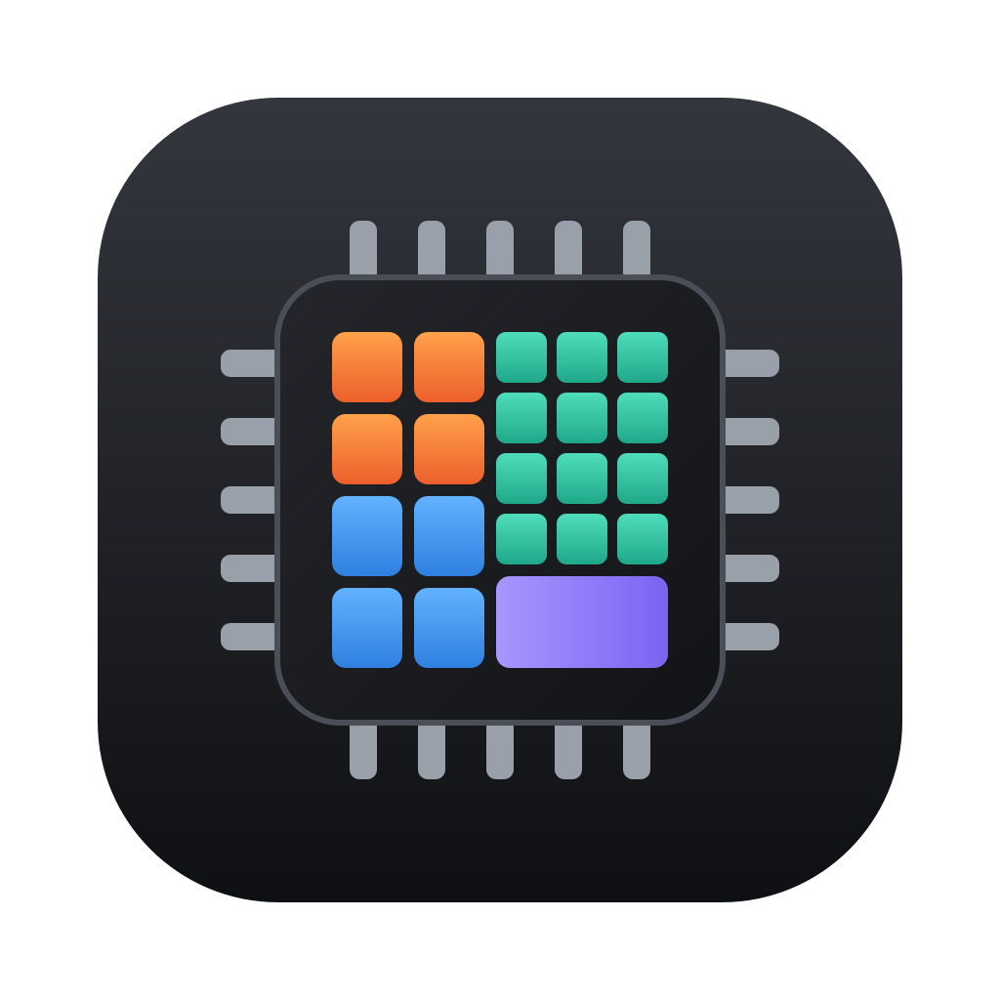

<div align="center">



# Silimon

**Your Apple Silicon Mac, at a glance.**

[](https://github.com/ndworks-dev/silimon/actions/workflows/ci.yml)


[](LICENSE)

**A native menu bar monitor for temperature, memory pressure, CPU, GPU and
power. Built with Rust and AppKit.**

[Install](#install) · [Features](#whats-in-the-menu) · [Building](#building) ·
[Releases](https://github.com/ndworks-dev/silimon/releases) · [Support](#support)

</div>

Silimon lives in the menu bar and shows only what you choose there: by default,
the CPU temperature. Open it for the whole picture, including the memory
pressure macOS itself uses to decide when memory is running short. No window,
no Dock icon, and no administrator password.

**Alpha · 0.1.2.** Apple Silicon only.

## Install

```sh
curl -fsSL https://ndworks.dev/silimon/install.sh | sh
```

The script downloads the latest release, checks its checksum and its Developer
ID signature, puts the app in `/Applications` and opens it. Run it again at any
time to reinstall.

[](https://ndworks.dev/silimon/download)

Prefer an installer? Download the `.dmg`, which is signed and notarized, and
drag the app to Applications.

## What's in the menu

### Menu bar

Open *Settings* from the menu, or press ⌘, while it is open, and choose any mix of CPU and GPU temperature, CPU and GPU usage, memory pressure,
memory in use, swap, chip power and system power. Each readout reserves room for
its widest common value, so the numbers change and the menu bar stays still.

### Temperature

Thermal pressure as macOS reports it, the current CPU and GPU temperatures, and
a chart of the last few minutes.

### Memory

Memory pressure with its state (normal, warning or critical), a meter and its
recent history, beside memory in use and swap.

### Processors and power

Usage and frequency for each kind of CPU core and for the GPU, and power drawn
by the CPU, GPU, memory, Neural Engine, chip and whole system.

### Activity

Network and disk throughput, fan speed and battery state.

## Open at login

Turn on *Open at Login* in Settings to start Silimon when you sign in. It is off
until you choose it, and you can also change it in System Settings.

## Updates

The app checks the latest release when it opens and once a day, then asks before
updating. *Check for Updates* in Settings does the same on demand. An update is
installed only if its checksum matches and it carries this project's Developer
ID signature.

> [!NOTE]
> **GPU temperature is not available on the base Apple M1.** Its GPU sensors do
> not report a usable reading, so Silimon hides the value. Sensors vary by chip
> and Mac model: any other chip shows it whenever its sensors report a valid
> reading.

## Privacy

Silimon sends no telemetry. Its only network access is the update check and
download, both from GitHub. Your menu bar choices stay in the app's preferences
on your Mac.

## Building

Install Rust and the Xcode command line tools, then, from the repository root:

```sh
cargo test             # unit tests
scripts/bundle.sh      # dist/Silimon.app, signed ad hoc
open dist/Silimon.app
```

`scripts/make-icon.sh` regenerates `assets/Silimon.icns` from `assets/icon.svg`.

## Architecture

```
src/main.rs       entry point
src/app.rs        status item, menu, background sampling and update flow
src/dashboard.rs  the panel drawn inside the menu
src/metrics.rs    menu bar selection, formatting and history, free of AppKit
src/prefs.rs      preferences
src/settings.rs   the settings window
src/login_item.rs opening the app at login
src/update.rs     update check, verification and replacement of the app
src/snapshot.rs   renders the panel to a PNG, for checking the layout
scripts/          bundling, release and the install script
```

Sensor access comes from the [macmon](https://github.com/vladkens/macmon) library.

## Making a release

The Developer ID certificate lives in a keychain, so a release is made from a
Mac that has it. Set the version in `Cargo.toml`, describe it in
`release-notes/v<version>.md`, then:

```sh
cp scripts/build-release.env.example scripts/build-release.env  # once, and fill it in
git tag v0.1.2 && git push origin v0.1.2
scripts/build-release.sh --release
```

The script runs the tests, builds the app, has Apple notarize it, and publishes
`Silimon.dmg`, `Silimon.zip`, `latest.json` and `install.sh`. It refuses a commit
that is not the tagged one. Publishing is what offers the version to every
install.

## Support

Silimon is free. If it is useful to you, you can support its development on
Ko-fi, also from *Support* at the end of Settings.

<a href="https://ko-fi.com/nickolasdeluca"></a>

## License

[MIT](LICENSE)
